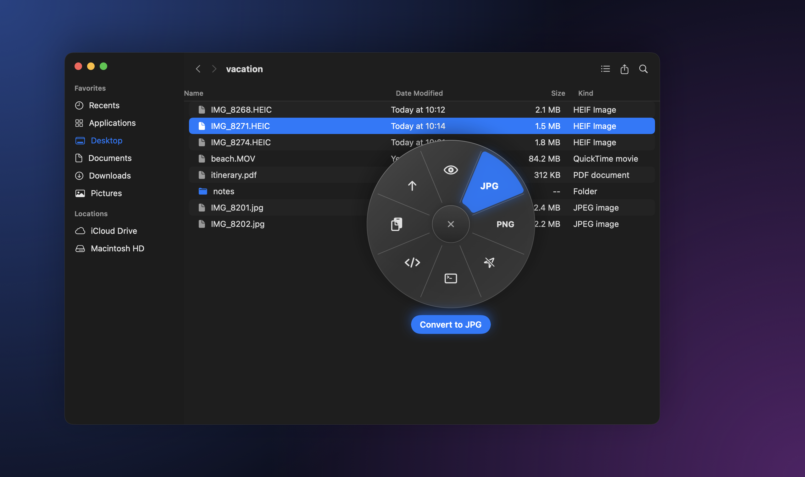
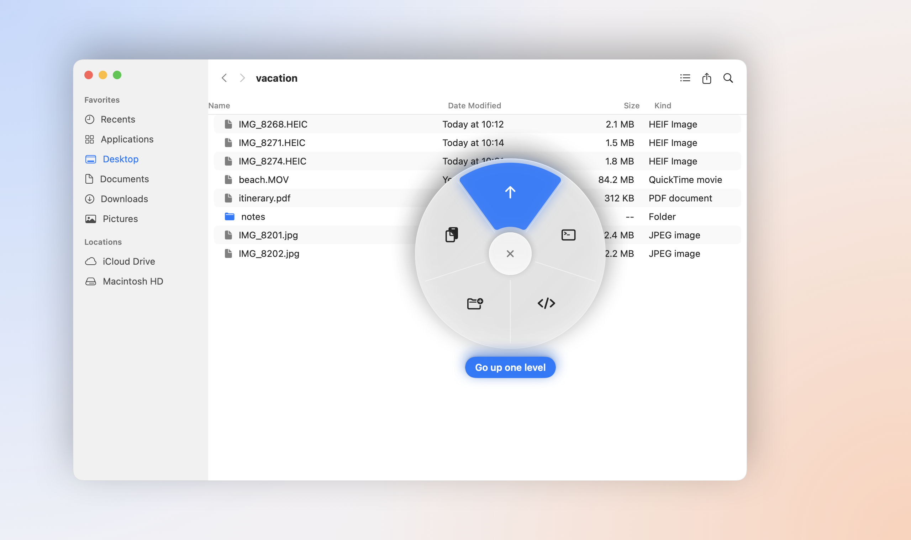
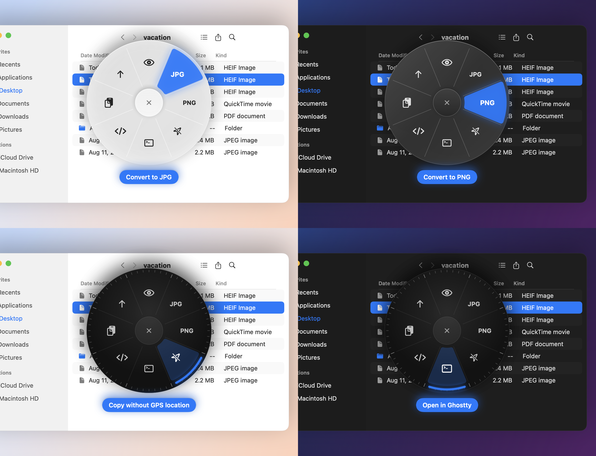
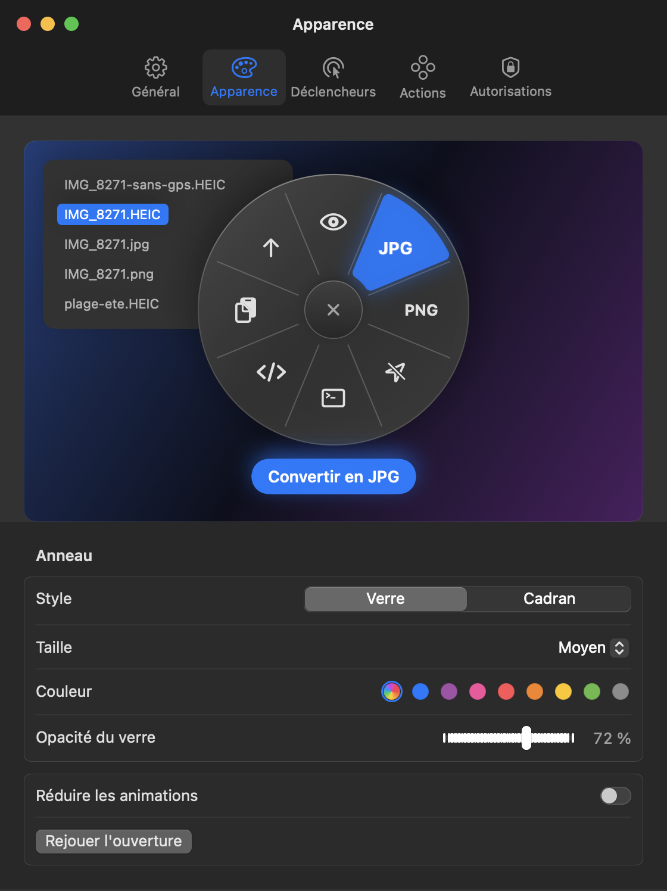

<div align="center">

# Ringlet

**A radial action ring for the macOS Finder.**
Select files, hold a key or a mouse button, flick toward an action, let go.




</div>

Ringlet puts the things you do to files all day (convert a photo, preview it, open a terminal there, copy its path,
go up a folder) one gesture away, right under the cursor. Pick by **direction**: no need to land on a slice, just
move toward it. Everything runs on your Mac, with Apple frameworks only.

> The interface is in French for now (*Convertir en JPG*, *Copier le chemin*…). English labels are welcome as a
> contribution.

## Open the ring

| How | Where | Notes |
| --- | --- | --- |
| Hold **`⌃⌥ Space`** | Anywhere | Changeable in Settings › Déclencheurs. Release on a slice to run it. |
| Hold the **right mouse button** | Finder | A quick right-click still opens the usual menu. The hold delay is adjustable. |
| **Middle** or **side** mouse button | Anywhere | Off by default. |
| **Services** menu | Finder right-click | *Convertir en JPG / PNG avec Ringlet*, no ring needed. |

Then move toward an action and release. Release without aiming and the ring stays open: click a slice, press
`Return`, or `Esc` to close. To cancel, come back to the **✕** in the middle or move out past the ring.

## Actions

The ring only offers what applies to **every** selected file. Created files land next to the originals (which are
never modified); a name that is already taken becomes `IMG_8271 2.jpg`.

| Selection | Actions |
| --- | --- |
| Any file or folder | **Preview** (Quick Look, like `Space`), **open in your terminal** (Ghostty, Terminal, iTerm…), **open in your code editor** (VS Code, Cursor, Zed…), **copy the path**, **go up** a folder (like `⌘↑`) |
| HEIC / HEIF photos | **Convert to JPG** (quality adjustable) or **PNG**, straightened, with date, camera, GPS and color profile kept |
| HEIC, JPEG, PNG, TIFF | **Copy without GPS location**: only the location tags are removed, pixels are untouched |
| Videos | **Convert to MP4** (for non-MP4 files), **shrink to 720p**, **extract the audio** (M4A) |
| Empty Finder area | **Go up**, **open the terminal here**, **open in your editor** (VS Code, Cursor, Zed…), **new folder**, **copy the folder path** |

<p align="center">
  
</p>

## Two styles

**Verre** (frosted glass, opacity adjustable) or **Cadran** (a dark HUD dial with a lit bezel), in the macOS accent
color or one of your choice, in three sizes. Both follow light and dark mode and honor *Reduce motion*.

<p align="center">
  
</p>

<p align="center">
  
</p>

## Install

There is no notarized download yet, so build it from source. You need macOS 14 or later and Xcode 16 (Swift 6).

```sh
git clone https://github.com/Snouzy/ringlet.git
cd ringlet
./scripts/install.sh   # builds Ringlet.app, copies it to ~/Applications and launches it
```

Ringlet lives in the menu bar. Its settings open on first launch; *Lancer Ringlet à l'ouverture de session* starts
it at login.

### Permissions

| Permission | Why | When |
| --- | --- | --- |
| **Automation › Finder** | Read the selection, go up, create a folder | Asked the first time you open the ring |
| **Accessibility** | Only for the mouse triggers (right-click hold, mouse buttons) | Asked when you turn one on |

Ringlet makes no network connection and collects nothing.

`scripts/build-app.sh` signs with your *Developer ID Application* certificate when one is in the keychain, and ad
hoc otherwise. With an ad hoc signature, macOS forgets the permissions after every rebuild.

If you type with several input sources, macOS already uses `⌃⌥ Space` to switch between them: pick another shortcut
in Settings › Déclencheurs.

## Development

```sh
swift test                 # core tests: ring geometry, action catalog, naming, real HEIC, GPS and video exports
./scripts/install.sh       # rebuild and relaunch the app (Swift has no hot reload)
./scripts/screenshots.sh   # re-render the README images off screen, from the real SwiftUI views
```

- `Sources/RingletCore`: everything testable without a screen (geometry, which actions fit a selection, output
  names, ImageIO conversions, GPS removal, AVFoundation exports).
- `Sources/RingletApp`: the menu bar app (global shortcut, mouse event tap, Finder scripting, the ring panel,
  settings, Services).
- `docs/specs`: the design notes; `prototype/`: the HTML prototype the ring came from.

## License

[MIT](LICENSE)

---

<details>
<summary><strong>En français</strong></summary>

Ringlet est un anneau d'actions pour le Finder. Tu sélectionnes des fichiers, tu maintiens `⌃⌥ Espace`, le clic droit
(dans le Finder) ou un bouton de souris, tu pars vers une action et tu relâches. On choisit par la direction, sans
viser précisément ; relâcher sur la croix ou hors de l'anneau annule.

- **Sur tous les fichiers :** aperçu (Coup d'œil), ouvrir dans le terminal, ouvrir dans l'éditeur de code, copier le chemin, remonter d'un niveau.
- **Photos HEIC :** convertir en JPG ou en PNG, métadonnées conservées.
- **Photos :** copie sans position GPS.
- **Vidéos :** MP4, 720p, extraire l'audio.
- **Dans le vide d'une fenêtre :** l'anneau du dossier (terminal, éditeur, nouveau dossier, chemin, remonter).

Deux styles au choix, Verre ou Cadran, avec la couleur et la taille réglables. Les fichiers créés vont à côté des
originaux, qui ne sont jamais modifiés. Tout reste sur ton Mac.

Installation : `./scripts/install.sh` (macOS 14+, Xcode 16).

</details>
