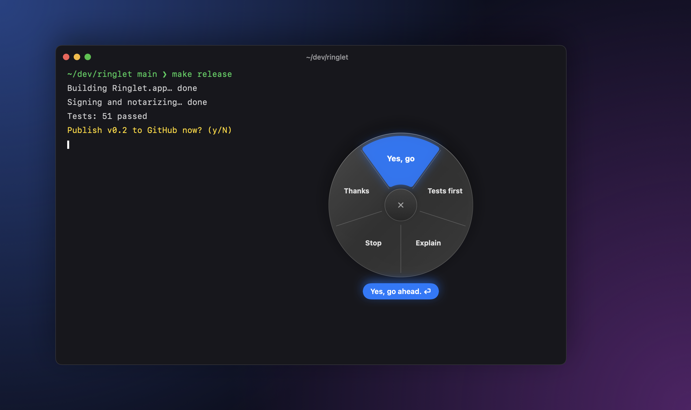
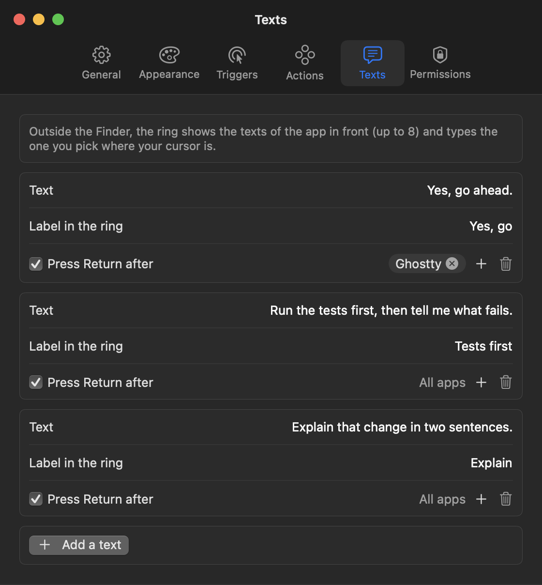

<div align="center">

# Ringlet

**A radial pie menu for the macOS Finder.**
Select files, hold a key or a mouse button, flick toward an action, let go.


</div>

Ringlet is a free, open-source menu bar app that puts the things you do to files all day one gesture away, right
under the cursor: **convert HEIC photos to JPG or PNG**, **remove the GPS location** from a photo, **convert a video
to MP4** or shrink it to 720p, preview with Quick Look, open the folder in your terminal or in VS Code, copy a path,
go up a folder. Pick by **direction**: no need to land on a slice, just move toward it. Everything runs on your Mac,
with Apple frameworks only (SwiftUI, ImageIO, AVFoundation).

> Available in **English** and **French**; Ringlet follows your Mac's language. To pick one for Ringlet only: System
> Settings › General › Language & Region › Applications. Other languages are welcome as a contribution
> (`Resources/Localizable.xcstrings`).

## Open the ring

| How | Where | Notes |
| --- | --- | --- |
| Hold **your shortcut** | Anywhere | None by default: record one in Settings › Triggers. Release on a slice to run it. |
| Hold the **right mouse button** | Finder | A quick right-click still opens the usual menu. The hold delay is adjustable. |
| **Middle** or **side** mouse button | Anywhere | Off by default. |
| **Services** menu | Finder right-click | *Convert to JPG / PNG with Ringlet*, no ring needed. |

Then move toward an action and release. Release without aiming and the ring stays open: click a slice, press
`Return`, or `Esc` to close. To cancel, come back to the **✕** in the middle or move out past the ring.

## Actions

The ring only offers what applies to **every** selected file. Created files land next to the originals (which are
never modified); a name that is already taken becomes `IMG_8271 2.jpg`.

| Selection | Actions |
| --- | --- |
| Any file or folder | **Preview** (Quick Look, like `Space`), **open in your terminal** (Ghostty, Terminal, iTerm…), **open in your code editor** (VS Code, Cursor, Zed…), **copy the path**, **go up** a folder (like `⌘↑`) |
| HEIC / HEIF photos | **Convert to JPG** (quality adjustable) or **PNG**, straightened, with date, camera, GPS and color profile kept |
| HEIC, JPEG, PNG, TIFF | **Copy without GPS location**: only the location tags are removed, pixels are untouched |
| Videos | **Convert to MP4** (for non-MP4 files), **shrink to 720p**, **extract the audio** (M4A) |
| Empty Finder area | **Go up**, **open the terminal here**, **open in your editor** (VS Code, Cursor, Zed…), **new folder**, **copy the folder path** |

<p align="center">
  
</p>

## Texts in any app

Outside the Finder, the ring shows **your own texts** for the app in front and types the one you pick where your
cursor is, without touching the clipboard. Answer a coding agent in your terminal with *Yes, go ahead.* in one
gesture, or keep canned replies for Slack. Each text can press **Return** after, and appears in every app or only in
the ones you choose (up to 8 per ring). Set them up in Settings › Texts; typing needs the Accessibility permission.

<p align="center">
  
</p>

<p align="center">
  
</p>

## Two styles

**Glass** (frosted, opacity adjustable) or **Dial** (a dark HUD dial with a lit bezel), in the macOS accent
color or one of your choice, in three sizes. Both follow light and dark mode and honor *Reduce motion*.

<p align="center">
  
</p>

<p align="center">
  
</p>

## Install

There is no notarized download yet, so build it from source. You need macOS 14 or later and Xcode 16 (Swift 6).

```sh
git clone https://github.com/Snouzy/ringlet.git
cd ringlet
./scripts/install.sh   # builds Ringlet.app, copies it to ~/Applications and launches it
```

Ringlet lives in the menu bar. Its settings open on first launch; *Open Ringlet at login* starts
it at login.

### Permissions

| Permission | Why | When |
| --- | --- | --- |
| **Automation › Finder** | Read the selection, go up, create a folder | Asked the first time you open the ring |
| **Accessibility** | Only for the mouse triggers (right-click hold, mouse buttons) | Asked when you turn one on |

Ringlet makes no network connection and collects nothing.

`scripts/build-app.sh` signs with your *Developer ID Application* certificate when one is in the keychain, and ad
hoc otherwise. With an ad hoc signature, macOS forgets the permissions after every rebuild.

Ringlet sets no keyboard shortcut by default, so it never takes one another app relies on. When you pick one, avoid
`⌃ Space` and `⌃⌥ Space`: macOS uses them to switch input sources.

## Development

```sh
swift test                 # core tests: ring geometry, action catalog, naming, real HEIC, GPS and video exports
./scripts/install.sh       # rebuild and relaunch the app (Swift has no hot reload)
./scripts/screenshots.sh   # re-render the README images off screen, from the real SwiftUI views
```

- `Sources/RingletCore`: everything testable without a screen (geometry, which actions fit a selection, output
  names, ImageIO conversions, GPS removal, AVFoundation exports).
- `Sources/RingletApp`: the menu bar app (global shortcut, mouse event tap, Finder scripting, the ring panel,
  settings, Services).
- `docs/specs`: the design notes; `prototype/`: the HTML prototype the ring came from.

## FAQ

**How do I convert HEIC to JPG on a Mac without an online converter?**
Select the photos in the Finder, open the ring and pick *Convert to JPG* (or *PNG*). The JPG is written next to the
original with its date, camera, GPS and color profile; the HEIC is left untouched. Without the ring, right-click ›
Services › *Convert to JPG with Ringlet* does the same.

**How do I remove the location from a photo before sharing it?**
*Copy without GPS location* writes a copy (`IMG_8271-no-gps.HEIC`) with only the GPS tags removed. The pixels are not
re-encoded.

**Does it upload my files?**
No. Ringlet makes no network connection; conversions use the frameworks built into macOS.

**Is it a Finder extension?**
No, it is a small menu bar app. It reads the Finder selection with Apple Events, so it works with any Finder window
and on the Desktop, and needs no Finder Sync extension.

## License

[MIT](LICENSE)

---

<details>
<summary><strong>En français</strong></summary>

Ringlet est un anneau d'actions pour le Finder. Tu sélectionnes des fichiers, tu maintiens ton raccourci (aucun par défaut), le clic droit
(dans le Finder) ou un bouton de souris, tu pars vers une action et tu relâches. On choisit par la direction, sans
viser précisément ; relâcher sur la croix ou hors de l'anneau annule. L'app est en français sur un Mac en français,
en anglais sinon.

- **Sur tous les fichiers :** aperçu (Coup d'œil), ouvrir dans le terminal, ouvrir dans l'éditeur de code, copier le chemin, remonter d'un niveau.
- **Photos HEIC :** convertir en JPG ou en PNG, métadonnées conservées.
- **Photos :** copie sans position GPS.
- **Vidéos :** MP4, 720p, extraire l'audio.
- **Dans le vide d'une fenêtre :** l'anneau du dossier (terminal, éditeur, nouveau dossier, chemin, remonter).
- **Hors du Finder :** tes textes à toi (« OK, oui vas-y. »), tapés là où est le curseur, avec Entrée si tu veux, dans les apps de ton choix.

Deux styles au choix, Verre ou Cadran, avec la couleur et la taille réglables. Les fichiers créés vont à côté des
originaux, qui ne sont jamais modifiés. Tout reste sur ton Mac.

Installation : `./scripts/install.sh` (macOS 14+, Xcode 16).

</details>
